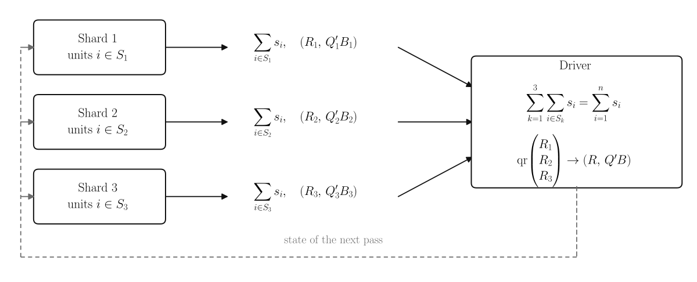

.. _dev-shards:

Fits on shards
==============

When a panel sits in a Spark DataFrame, the two things an in-memory fit leans
on can't come to the driver. The rows of the panel may be too many for one
machine. The influence function matrix holds a row for every unit and may be
too large as well. We made ``att_gt`` work on a cluster by rewriting it around
one idea. Every quantity the estimator needs is a sum over units or something
the driver can compute from such sums. When each block of units computes its
share wherever it lives, the driver only has to add the shares up. One round of
that exchange is a pass of the fit, as the figure below shows.

A dashed path carries the state of the next pass back to every shard.
   :width: 100%

   Each shard returns the sum of a statistic :math:`s_i` over its own units and
   the QR factors :math:`(R_k, Q_k'B_k)` of its own rows. The driver adds the
   sums and refactors the stacked factors. It then sends the state of the next
   pass back to the shards.

We'll rebuild the county fit from the :doc:`architecture guide <architecture>`
out of three blocks of counties to show how that works on a balanced panel. A
:doc:`second engine <row_shards>` carries the same idea over to repeated
cross-sections and unbalanced panels. The :ref:`Spark guide <spark>` walks
through such fits from the user's side. The block below rebuilds the county
fit and its prepared sample.

.. code-block:: python

   import moderndid as did
   import numpy as np

   data = did.load_mpdta()
   columns = {
       "yname": "lemp",
       "tname": "year",
       "gname": "first.treat",
       "idname": "countyreal",
       "xformla": "~ lpop",
   }
   result = did.att_gt(data, **columns, boot=False, cband=False)
   prepared = did.preprocess_did(data, **columns)

Splitting the units into shards
-------------------------------

A shard holds whole units, each with every period of its outcome, weights, and
covariates. Any statistic that sums over units therefore adds up across shards
however the units were split. Because each unit holds an outcome for every
period, the panel engine that reads these shards fits balanced panels. It also
fits a panel passed with ``allow_unbalanced_panel=True`` whose units all turn
out complete. Since preprocessing leaves ``config.panel`` True for such a
panel, the in-memory fit treats it as balanced too. We'll split the prepared
county panel into three shards with ``shards_from_did_data``. The parity tests
make their shards with the same function.

.. code-block:: python

   from moderndid.did.shards.local import shards_from_did_data

   shards = shards_from_did_data(prepared, 3, random_state=0)

   print("Units per shard:", [len(shard.unit_keys) for shard in shards])
   print("Outcomes of the first shard:", shards[0].y.shape)
   print("Covariates of the first shard:", shards[0].covariates.shape)

.. container:: cell_output

   .. container:: output stream

      .. code-block:: text

         Units per shard: [167, 167, 166]
         Outcomes of the first shard: (167, 5)
         Covariates of the first shard: (167, 5, 1)

Each of the 500 counties went whole to one shard and kept its outcome in all
five years. The covariate array leaves out the intercept because the kernels
add it back.

Statistics that add up across shards
------------------------------------

A kernel is how the engine computes a statistic on a shard. It takes one shard
and the state of a pass and returns a ``Partial`` that holds the named
statistics of the shard's units. An executor runs a kernel on every shard and
combines the partials. The kernel below counts a shard's units and sums their
outcomes in each year. ``LocalExecutor``, the executor for shards held in
memory, adds up those sums across the three shards.

.. code-block:: python

   from moderndid.did.shards.container import Partial
   from moderndid.did.shards.local import LocalExecutor

   def outcome_sums(shard, state):
       # Each shard counts its units and sums their outcomes in every period.
       sums = {"units": len(shard.unit_keys), "outcomes": shard.y.sum(axis=0)}
       return Partial(sums=sums, maxima={}, factors={}, keyed={})

   # The executor runs the kernel on every shard and adds up the sums.
   totals = LocalExecutor(shards).run(outcome_sums, None)
   sharded_means = totals.sums["outcomes"] / totals.sums["units"]

   # The same means from the prepared arrays, which hold every unit at once.
   memory_means = np.array([outcomes.mean() for outcomes in prepared.outcomes_tensor])

   print("Mean outcome by year:", np.round(sharded_means, 4))
   print("Means agree:", np.allclose(sharded_means, memory_means))

.. container:: cell_output

   .. container:: output stream

      .. code-block:: text

         Mean outcome by year: [5.7985 5.744  5.7535 5.7764 5.7903]
         Means agree: True

From the combined sums, the driver gets the mean outcome of each year. Those
means match the ones from the prepared arrays that hold all 500 counties at
once. A kernel defined in a session like this one works only through
``LocalExecutor``. The :ref:`rules for Spark code <dev-spark-rules>` explain
why a kernel that runs on Spark lives in an importable module.

Normal equations summed across shards would also give a regression. They drift
from the in-memory coefficients as a design's condition number grows, though.
Each shard therefore returns the QR factors :math:`(R, Q'B)` of its own rows
instead. Stacking two pairs and factoring again gives the pair for all their
rows in a tall-skinny QR factorization. Below, the first year's regression of
the outcome on log population comes out the same from three shards as from all
the counties at once.

.. code-block:: python

   def first_year_factors(shard, state):
       # QR factors of the first year's regression of the outcome on log population.
       design = np.column_stack([np.ones(len(shard.unit_keys)), shard.covariates[:, 0]])
       q, r = np.linalg.qr(design)
       return Partial(sums={}, maxima={}, factors={"ols": (r, q.T @ shard.y[:, [0]])}, keyed={})

   # Stacking the three shards' factors and factoring again gives those of all the units.
   r, qtb = LocalExecutor(shards).run(first_year_factors, None).factors["ols"]
   sharded_coefficients = np.linalg.solve(r, qtb).ravel()

   # The same regression on all 500 counties at once.
   memory_coefficients = np.linalg.lstsq(
       prepared.covariates_tensor[0], prepared.outcomes_tensor[0], rcond=None
   )[0]

   print("Coefficients:", np.round(sharded_coefficients, 4))
   print("Coefficients agree:", np.allclose(sharded_coefficients, memory_coefficients))

.. container:: cell_output

   .. container:: output stream

      .. code-block:: text

         Coefficients: [2.2067 1.0842]
         Coefficients agree: True

The driver solves the outcome regressions and each Newton step of the
propensity score fits from factors merged this way. The factors of the first
pass also decide which propensity score covariates a fit keeps. The driver
hands each fit's merged :math:`R` to ``_independent_columns`` in
``drdid/utils.py``, the same rule that the in-memory estimators apply to the
QR factor of their weighted design.

Partials also carry maxima, such as the largest weight, and keyed sums for
statistics of each cluster. Since a shard can hold part of a cluster, a keyed
sum adds the rows that share a cluster's key.

.. admonition:: A split cluster becomes two clusters
   :class: warning

   A keyed sum is final only once every unit of its key has arrived. If
   ``finalize_keyed`` turns it into a Gram matrix before then, a cluster whose
   units sit in two partials counts as two clusters.

Passes of a fit
---------------

A whole fit of ``att_gt`` is a sequence of such passes over the shards.
``fit_att_gt_on_shards`` runs each pass through an executor and solves on the
driver what the next pass needs. Given ``LocalExecutor`` and the county shards,
it rebuilds the in-memory ``result``.

.. code-block:: python

   from moderndid.did.shards.driver import fit_att_gt_on_shards

   # The fit runs every pass on the shards through the executor.
   executor = LocalExecutor(shards)
   settings = {"bootstrap": False, "uniform_bands": False}
   sharded = fit_att_gt_on_shards(executor, prepared.config, prepared.cohort_counts, None, settings)

   print("Passes over the shards:", executor.n_passes)
   print(f"Largest gap in the effects: {np.abs(sharded.att_gt - result.att_gt).max():.1e}")
   print(f"Largest gap in the standard errors: {np.abs(sharded.se_gt - result.se_gt).max():.1e}")

.. container:: cell_output

   .. container:: output stream

      .. code-block:: text

         Passes over the shards: 9
         Largest gap in the effects: 2.8e-17
         Largest gap in the standard errors: 1.4e-17

The effects and standard errors match the in-memory ``result`` up to the last
bits of rounding. The doubly robust fit made the nine passes below in order.
``irls_kernel`` ran once for each of the six iterations of its logits.

.. code-block:: text

   summary_kernel      counts, weight sums, and QR factors of the designs
   irls_kernel         one pass for each iteration of the propensity score fits
   cell_sums_kernel    the parts of every effect
   moments_kernel      the sums over units that InfluenceMoments holds

Before the first pass, ``plan_cells`` lists the group-time cells with the same
``cell_spec`` that the in-memory fit uses. Cells that agree on the treated
cohort, the comparison cohorts, and the earlier period use the same units,
covariates, and weights. One propensity score fit and one regression design
therefore serve all of them. On the county panel, the 12 cells share 8 fits.

.. admonition:: Key new options into the shared fits
   :class: important

   A new option that changes which units, covariates, or weights a cell uses
   belongs in that key. Leaving it out fails no test unless a parity test
   covers the option.

An outcome regression fit skips ``irls_kernel`` and makes three passes. The
propensity score fits repeat the in-memory binomial fit iteration by iteration
because each iteration whose scores separate the units adds a separation
warning. In memory, each cell fits its logit twice, once in the overlap screen
and once in its estimator. The engine therefore replays a shared fit's
warnings once for every cell in the screen and again at the cell's estimator.

Each pass costs a Spark action in which every task builds the factors and sums
of its own units. A task's work therefore grows with its rows. What it sends
back depends on the numbers of fits, cells, coefficients, draws, and clusters
rather than on its rows. For a fit with :math:`k` coefficients, the summary
pass and each logit iteration return a :math:`k \times k` triangular factor
that the driver solves on its own. The cell sums pass returns a few totals and
covariate products for each fit and cell. Only the moments pass returns rows
that grow with the number of effects and draws, as the next section shows.

A new statistic that needs the final logit coefficients belongs in
``cell_sums_kernel`` or ``moments_kernel`` rather than in a pass of its own.
``_finish_att_gt`` then assembles the result just as it does for an in-memory
fit.

Inference from sums over units
------------------------------

The influence functions behind the standard errors can't leave the shards
either. The last pass sums each unit's row :math:`z_i` into an
:class:`~moderndid.InfluenceMoments` instead. The row stacks the unit's
influence function for every effect, its first-period sampling weight in its
cohort's column, and a constant. The weight columns and the constant let an
aggregation add the influence function of the cohort probabilities it
estimates for its weights. Whenever the fit asks for the bootstrap or a
uniform band, the pass also returns the sum :math:`S_b` for each draw
:math:`b` of the multipliers :math:`v_{bi}`. A uniform band needs those draws
even when ``boot=False`` because ``aggte`` inherits ``cband`` and draws for
its band.

.. math::

   Z'Z = \sum_{i=1}^{n} z_i z_i', \qquad
   S_b = \sum_{i=1}^{n} v_{bi} z_i, \qquad
   \hat\sigma_c^2 = \frac{c'\,Z'Z\,c}{n^2}

Since every aggregated influence function is a linear combination
:math:`c'z_i` of each unit's row, the variance of any aggregation follows from
:math:`Z'Z` alone. A clustered fit uses the Gram matrix of the cluster sums in
its place. The first block of :math:`Z'Z` is ``psi.T @ psi`` for the
influence function matrix ``psi`` of the in-memory fit. The shard fit's
covariance and its event study therefore match the in-memory ones.

.. code-block:: python

   moments = sharded.influence_moments
   k = len(result.att_gt)

   # The in-memory influence functions and the covariance they give.
   psi = result.influence_func
   n = result.n_units
   contribution_variance = psi.T @ psi / n

   # The influence functions fill the first k entries of each unit's row.
   print("Length of each unit's row:", moments.gram.shape[0])
   print("Covariance agrees:", np.allclose(moments.gram[:k, :k] / n, contribution_variance))

   # An event study aggregates from those sums alone.
   sharded_study = did.aggte(sharded, type="dynamic")
   memory_study = did.aggte(result, type="dynamic")
   print("Event study errors agree:", np.allclose(sharded_study.se_by_event, memory_study.se_by_event))

.. container:: cell_output

   .. container:: output stream

      .. code-block:: text

         Length of each unit's row: 16
         Covariance agrees: True
         Event study errors agree: True

Each row holds the 12 influence functions, the weights of the three treated
cohorts, and the constant. ``_UnitLevelEvaluator`` and ``_MomentEvaluator``
apply the same coefficient columns to the unit rows of an in-memory fit and to
the sums of a fit on shards.

.. admonition:: Change an aggregation through its coefficients
   :class: important

   A change to an aggregation belongs in its coefficient columns, never in code
   that reads ``influence_func``, ``G``, or ``weights_ind`` directly. A fit on
   shards leaves all three of those fields as None.

For :math:`B` draws and the :math:`L` entries of :math:`z_i`, each row that
``moments_kernel`` returns takes about :math:`8L(L + B)` bytes. A clustered fit
that keeps whole clusters adds another :math:`8L^2` bytes for its cluster Gram
matrix. One that spreads its clusters adds about :math:`8(L + 1)` bytes for
each cluster the task touched instead. The :ref:`troubleshooting section
<spark-troubleshooting>` of the setup guide covers the limits these rows can
reach.

.. _dev-shard-draws:

Random draws on shards
----------------------

In memory, ``multiplier_bootstrap`` draws the random sign of each unit, or of
each cluster in a clustered fit, from one random stream in the order of the
units or clusters. Since the way a Spark table's rows fall into partitions
changes with the executors, adaptive query execution, and the data source, the
table offers no such order.

Each multiplier on shards is instead a pure function of the seed, the draw, and
the key of its unit or cluster. ``canonical_keys`` turns each identifier into a
64-bit key that depends only on its value. ``keyed_rademacher`` then turns the
seed and each key into signs with the counter-based generator Philox4x32-10 of
`Salmon et al. (2011) <https://doi.org/10.1145/2063384.2063405>`_. `Chamandy et
al. (2012)
<https://research.google/pubs/estimating-uncertainty-for-massive-data-streams/>`_
key the bootstrap weights of each user in a sharded data stream to the user's
identifier for the same reason.

.. code-block:: python

   from moderndid.core.bootstrap import canonical_keys, keyed_rademacher

   # The signs of the 500 counties in 1,000 draws from seed 7.
   counties = prepared.time_invariant_data["countyreal"].to_numpy()
   signs = keyed_rademacher(canonical_keys(counties), 7, 1000)

   # The same seed with the counties reversed, stored as floats, or drawn 300 times.
   reversed_signs = keyed_rademacher(canonical_keys(counties[::-1]), 7, 1000)
   float_signs = keyed_rademacher(canonical_keys(counties.astype(float)), 7, 1000)
   first_draws = keyed_rademacher(canonical_keys(counties), 7, 300)

   print("Same signs in reverse order:", np.array_equal(signs[::-1], reversed_signs))
   print("Same signs from float identifiers:", np.array_equal(signs, float_signs))
   print("Same first 300 draws:", np.array_equal(signs[:, :300], first_draws))

.. container:: cell_output

   .. container:: output stream

      .. code-block:: text

         Same signs in reverse order: True
         Same signs from float identifiers: True
         Same first 300 draws: True

Every partitioning and every rerun of a task therefore gives the same draws.
An integer and a float that hold the same whole number share a key. A string
takes its 8-byte BLAKE2b digest because Python salts its built-in ``hash`` anew
in every process. Because draw :math:`b` always comes from block
:math:`\lfloor b / 128 \rfloor`, an aggregation with a smaller ``biters`` sees
the same signs as a fit run with that ``biters``.

.. admonition:: Seeds by partition change the draws
   :class: warning

   A new random draw on shards takes its signs from ``keyed_rademacher`` on
   ``canonical_keys``. It never seeds them by partition or by task, as Spark's
   ``rand`` function does, or keys them by Python's ``hash`` of a string.

Since ``keyed_rademacher`` computes Philox in NumPy's integer arithmetic rather
than through a ``Generator``, the signs stay the same whatever NumPy version an
executor runs. ``tests/core/test_bootstrap.py`` pins the generator to the
known-answer vectors of the Random123 library. A change to the signs fails
tests in that file and changes every bootstrap number that a Spark fit reports
for a seed.

Every pass on this page reads shards whose units hold an outcome in every
period. The guide to :doc:`rows on shards <row_shards>` shows how the same
passes, sums, and keyed draws fit repeated cross-sections and unbalanced
panels.
